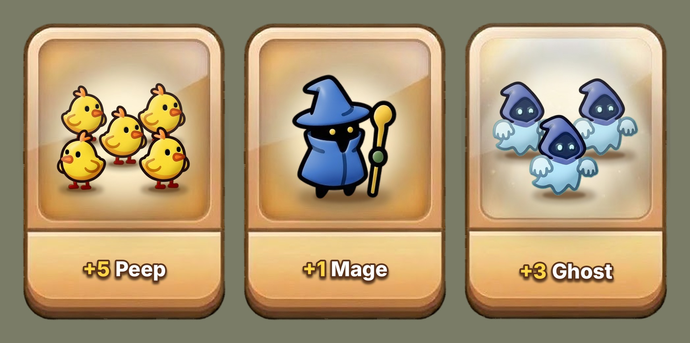

# GameAssets

Staging area for the next game's assets and working scripts. Once everything is ready,
it moves into the main project repo.

## Layout

- [`brawlers/`](brawlers/): brawler sprites (transparent PNGs)
  - `<name>.png`: flat sprites
  - `shaded/<name>.png`: the same sprites with 3D shading
  - `sizes.json`: each brawler's display name and relative size
  - `source/`: the original images
- [`cards/`](cards/): backgrounds for the "choose a card" screen (basic and jackpot), with the original in `cards/source/`
- [`examples/`](examples/): previews of how the brawlers look on the cards (not game assets)
- [`scripts/`](scripts/): helper scripts
  - `extract_brawlers.py` cuts the brawler sprites out of their source images
  - `shade_brawlers.py` adds the 3D shading to the flat sprites
  - `extract_cards.py` cuts the basic and jackpot cards out of their source image
  - `make_card_examples.py` renders the previews in `examples/`
