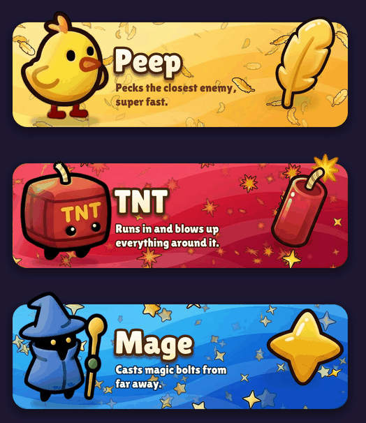

# GameAssets

Staging area for the next game's assets and working scripts. Once everything is ready,
it moves into the main project repo.

Three of the seven brawler cards, stacked like on the screen. All seven are in [`cards/`](cards/).

## Layout

- [`brawlers/`](brawlers/): brawler sprites (transparent PNGs)
  - `<name>.png`: flat sprites
  - `shaded/<name>.png`: the same sprites with 3D shading
  - `shaded_mirrored/<name>.png`: the shaded sprites facing the other way
  - `sizes.json`: each brawler's display name and relative size
  - `source/`: the original images
- [`cards/`](cards/): the cards for the "choose a card" screen: one wide card per brawler in its colour, with its 3D object and drifting particles. The folders use the sprite names: `chick` is Peep, `wizard` is the Mage and `acorn` is Mr Nut. `cards.json` describes how to draw and move them. The originals are in `cards/source/`
- [`animations/`](animations/): walk and attack animations for every brawler: 4 drawn poses each, the smooth motion that plays on top of them, and their effects (fire or a spark for an attack, dust or sparkles for the steps). `animations.json` describes how to play them. The originals are in `animations/source/`
- [`maps/`](maps/): the map at the top of the main screen, one per area (the forest so far): a path seen from above between two walls, about 5 screens long, that loops. `map.json` says where characters walk and where every decoration is. The originals are in `maps/<area>/source/`
- [`examples/`](examples/): previews of how the brawlers look on the cards, in motion and on the map (not game assets)
- [`fonts/`](fonts/): Lilita One, the font for names and skill text on the cards (free under the SIL Open Font License, in `fonts/OFL.txt`)
- [`scripts/`](scripts/): helper scripts
  - `extract_brawlers.py` cuts the brawler sprites out of their source images
  - `shade_brawlers.py` adds the 3D shading to the flat sprites and makes the mirrored versions
  - `extract_animations.py` turns the animation sheets into sprite strips and a moving preview
  - `brawler_motion.py` describes the smooth motion of every brawler's walk and attack
  - `animation_effects.py` cuts the attack and walking effects out of their sheets and fits each one to its brawler
  - `trace_shapes.py` traces flat shapes out of a green screen, crisp and in their exact colours (used by `animation_effects.py`)
  - `make_brawler_cards.py` builds the cards from their sheets, with stills and moving previews
  - `make_map.py` builds each area's long, looping map from its two pictures, with previews
  - `make_examples.py` renders the size lineup and the flat-vs-shaded comparison in `examples/`
