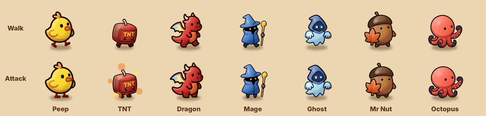

# Animations

Walk and attack animations for the 7 brawlers. Each one is made of two things that are played
together:

- **4 drawn poses**, as a sprite strip
- **a smooth motion** on top of them: the whole sprite bobs, rocks, squashes and stretches
  while it walks, and pulls back and darts forward when it attacks



The poses alone are about 8 pictures a second, which looks choppy however well they are drawn.
The motion is what makes the animation smooth, so a game should use both. The preview above
plays them together at 25 pictures a second; a game can go faster still.

In the preview every brawler is drawn at the same size, so the motion is easy to judge. Their
real sizes relative to each other are in [`brawlers/sizes.json`](../brawlers/sizes.json).

## Files

Each brawler has a folder with four sprite strips. A strip is 4 poses side by side.

| File | What it is |
|---|---|
| `walk.png` | Walk cycle, loops |
| `attack.png` | Attack, plays once |
| `walk_mirrored.png`, `attack_mirrored.png` | The same, facing the other way |

The poses are shaded like the sprites in `brawlers/shaded/`, at half their pixel size (the
same size as the flat sprites in `brawlers/`).

Use the mirrored strips when a brawler faces the other way. Do not flip a strip in the game:
its light would flip too, and the TNT's letters would read backwards.

[`animations.json`](animations.json) has everything else a game needs. For each brawler:

| Brawler | Folder | Frame size (px) | Anchor (x, y) |
|---|---|---|---|
| Peep | `chick/` | 242 × 273 | 121, 267 |
| TNT | `tnt/` | 280 × 333 | 140, 327 |
| Dragon | `dragon/` | 282 × 261 | 141, 255 |
| Mage | `wizard/` | 376 × 316 | 188, 310 |
| Ghost | `ghost/` | 336 × 318 | 168, 312 |
| Mr Nut | `acorn/` | 298 × 238 | 149, 232 |
| Octopus | `octopus/` | 334 × 243 | 167, 237 |

And for each animation of a brawler:

| Field | Meaning |
|---|---|
| `duration_ms` | How long the animation takes: 520 ms for a walk cycle, 640 ms for an attack |
| `frame_ms` | How long each of the 4 poses is shown |
| `loop` | `true` for the walk, `false` for the attack |
| `hit_ms` | Attack only: the moment the hit lands |
| `returns_to_rest` | Attack only: `false` for the TNT, which ends on the pose before it bursts |
| `motion` | Five lists of 49 numbers: `x`, `y`, `rotate`, `scale_x`, `scale_y` |

## How to play them

At every screen refresh, with `t` the time since the animation started (for the walk, start
over whenever `t` reaches `duration_ms`):

1. **Pick the pose.** Cut the strip into 4 frames of the frame width and show the one whose
   turn it is, going by `frame_ms`.
2. **Read the motion.** The 49 numbers of each list are spread evenly from the start of the
   animation to its end. Find where `t` falls between two of them and blend the two.
3. **Draw the pose** with its anchor point on the brawler's spot on the ground, after:
   - stretching it by `scale_x` and `scale_y`, from the anchor point
   - turning it by `rotate` degrees clockwise, around the anchor point
   - moving it by `x` and `y` (in frame pixels; `y` is negative upwards)

Details:

- **Anchor:** the centre of the body on the ground line. It is in the same place in every
  frame of a brawler, so nothing jitters and walk and attack can be swapped freely.
- **Size:** scale each brawler by its `scale` in `brawlers/sizes.json`. Scale `x` and `y` by
  the same amount.
- **Mirrored strips:** flip the sign of `x` and `rotate`.
- **Standing still:** the last attack pose is the resting pose. For the TNT, use the last walk
  pose instead.
- **Effects:** no fire, magic or sparks are drawn into the poses. Add them in the game from
  [`effects/pieces/`](../effects/pieces/) at `hit_ms`, for example fire at the Dragon's mouth.
- **TNT:** its attack is the build-up to the explosion. It swells and shakes harder and
  harder, and should burst at `hit_ms`, which is the end of the animation.

## The motion

The motion is described in [`scripts/brawler_motion.py`](../scripts/brawler_motion.py), in two
short tables that are easy to change:

| Brawler | Walk | Attack |
|---|---|---|
| Peep, TNT, Dragon, Mage, Mr Nut | Waddle: lifts and stretches with every step, rocks from side to side | Lunge: pulls back, darts forward, lands, returns |
| Ghost | Float: drifts up and down, swaying | Lunge |
| Octopus | Crawl: flattens and rises as it pulls itself along | Lunge |
| TNT | Waddle | Swell: squashes, springs up, then swells and shakes |

The Mage and Mr Nut also hop a little while winding up, and the Dragon shakes while it holds
its fire breath. The poses change at the moments the sprite moves fastest, where the eye does
not catch the change.

What the motion cannot do is redraw the legs and arms: they still change in 4 steps. Making
those smoother too would take more drawn poses per animation.

## Known quirks

These come from the source sheets. To fix one, generate a new sheet for that brawler, replace
its file in `source/` and run the script again.

- **Mr Nut:** its legs barely move in the walk, so the walk comes almost entirely from the
  motion. On the third attack pose it is turned away, so its face is hidden.
- **Ghost:** on the second and third walk poses it turns sideways, so it changes shape more
  than the others.
- **TNT and Mage:** their feet are dark red and dark blue here, but black on the still sprites.

## Source

The original sheets are in [`source/`](source/), one per brawler: 8 poses on a green screen,
the walk on the top row and the attack on the bottom row.

The script cuts the poses out, brings them to one size, lines them up and shades them. Walk
poses are lined up by the body, with the feet on the ground. Attack poses are matched to the
resting pose where the two look the same, so the body stays put and only the parts that move,
move.

One pose is repaired along the way. On the TNT sheet, the third attack pose was drawn with a
second pair of squinting eyes where the letters "TNT" should be, so the box seemed to have
four eyes. The script removes that pair and copies the letters from the next pose.

To regenerate everything (needs `numpy` and `Pillow`; takes about a minute), run this from the
repo root:

```bash
python3 scripts/extract_animations.py
```
