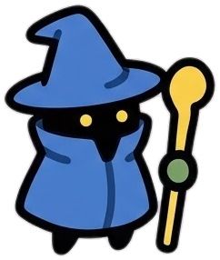
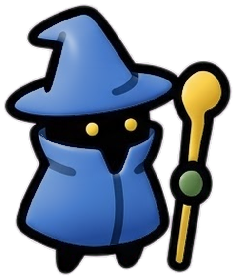
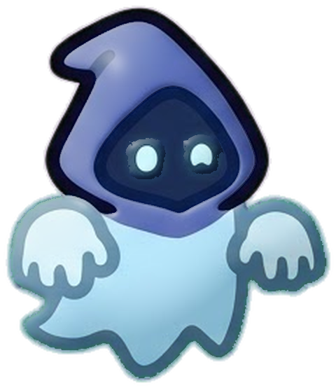
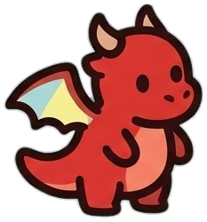
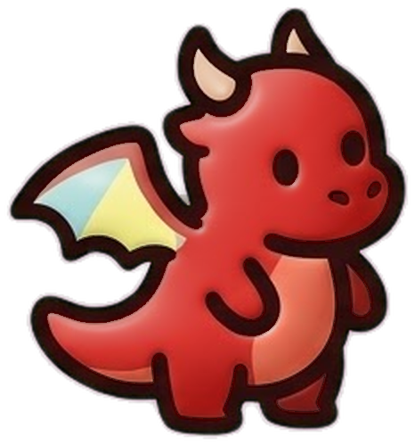
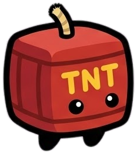
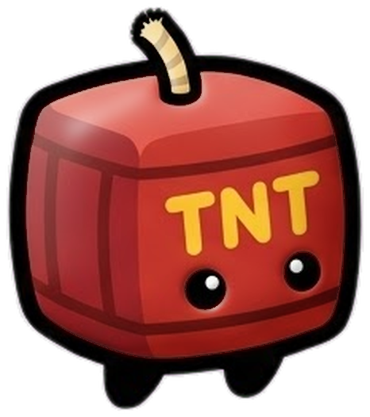
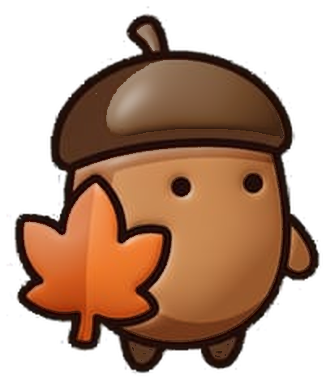
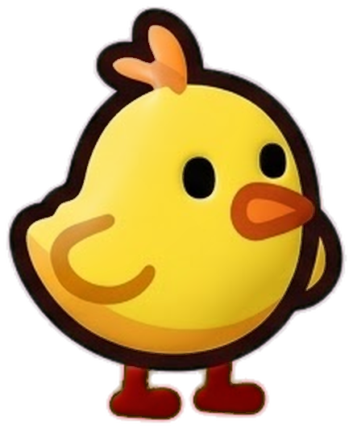

# Brawlers

Transparent PNG sprites, cropped tight with 4px padding. Each brawler comes in two versions:

- **Flat** (`<name>.png`): the original sprite.
- **Shaded** (`shaded/<name>.png`): the same design with soft 3D shading, at 2x the size.

| Flat | Shaded | Name | File | Flat size (px) | Scale |
|:---:|:---:|---|---|---|---|
|  |  | Mage | `wizard.png` | 242 × 286 | 1.0 |
|  |  | Ghost | `ghost.png` | 240 × 277 | 0.95 |
|  |  | Dragon | `dragon.png` | 233 × 250 | 0.9 |
|  |  | TNT | `tnt.png` | 233 × 263 | 0.75 |
|  |  | Octopus | `octopus.png` | 223 × 210 | 0.7 |
|  |  | Acorn | `acorn.png` | 201 × 235 | 0.55 |
|  |  | Peep | `chick.png` | 219 × 266 | 0.5 |

## Sizes

[`sizes.json`](sizes.json) holds each brawler's display name and its height relative to the
Mage (1.0). For example, a Peep (0.5) is drawn half as tall as a Mage. The sprite files are all
roughly the same size, so the game has to apply this scale when drawing them.

## Shading

The shaded sprites are calculated from the flat ones, so the designs are identical. Each
colour region (body, wing, hat...) is shaded like a rounded shape, lit from the top left, with
a few glossy highlights. Outlines and dark features are untouched.

To mirror a brawler, flip the flat sprite first and shade it afterwards, so the light still
comes from the top left. The TNT should never be mirrored because of its letters.

## Source

The original images are in [`source/`](source/):

- `greenscreen_sheet.jpg`: Peep, TNT, Dragon, Mage and Ghost on a green screen
- `acorn_black.png`, `octopus_black.png`: single brawlers on a black background

To regenerate everything from the originals (needs `numpy` and `Pillow`), run these from the repo root:

```bash
python3 scripts/extract_brawlers.py
```

```bash
python3 scripts/shade_brawlers.py
```
