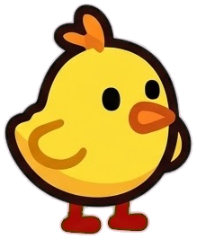
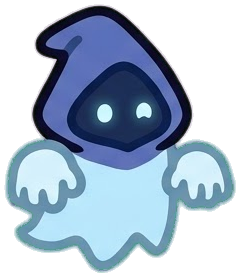

# Brawlers

Transparent PNG sprites, cropped tight with 4px padding.

| Preview | Name | File | Size (px) |
|:---:|---|---|---|
|  | Chick | `chick.png` | 219 × 266 |
|  | TNT | `tnt.png` | 233 × 263 |
|  | Dragon | `dragon.png` | 233 × 250 |
|  | Wizard | `wizard.png` | 242 × 286 |
|  | Ghost | `ghost.png` | 240 × 277 |
|  | Acorn | `acorn.png` | 201 × 235 |
|  | Octopus | `octopus.png` | 223 × 210 |

## Source

The original images are in [`source/`](source/):

- `greenscreen_sheet.jpg`: Chick, TNT, Dragon, Wizard and Ghost on a green screen
- `acorn_black.png`, `octopus_black.png`: single brawlers on a black background

To regenerate the sprites from the originals (needs `numpy` and `Pillow`), run this from the repo root:

```bash
python3 scripts/extract_brawlers.py
```
