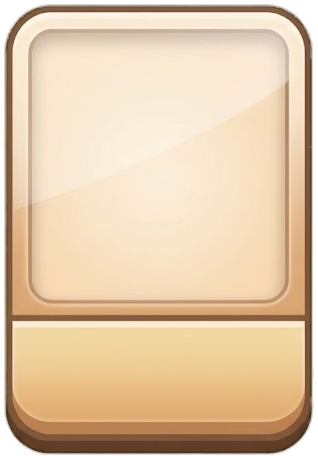

# Cards

Backgrounds for the "choose a card" screen. Transparent PNGs, 318 × 459 px (4px padding included).

| Preview | Name | File |
|:---:|---|---|
|  | Basic | `basic.png` |
|  | Jackpot | `jackpot.png` |

Both cards share exactly the same frame. The jackpot card is the basic card with a warm
glow and light rays drawn inside its window.

## Layout

- **Window** (top): about 251 × 265 px, for the brawler
- **Label panel** (bottom): for a short text such as `+2 TNT`

## Source

The original image is in [`source/`](source/): `cards_greenscreen.jpg`, two cards on a green
screen. Only the left card is used. The right one had light leaking past its edge, so the
jackpot card is generated from the basic one.

To regenerate both cards (needs `numpy` and `Pillow`), run this from the repo root:

```bash
python3 scripts/extract_cards.py
```
