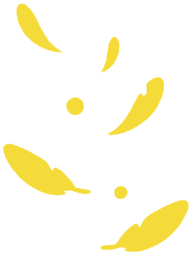
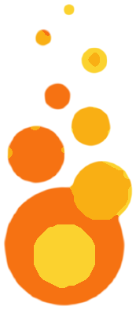
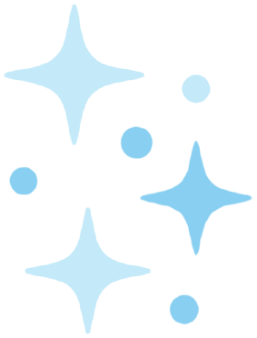
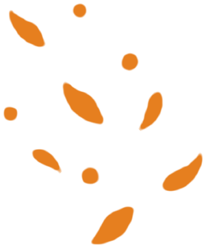
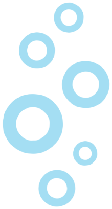

# Effects

Small particle effects for the brawlers: flat shapes in one or two colours, with no outlines
and no detail. Transparent PNGs.

| Preview | File | Brawler | What it is |
|:---:|---|---|---|
|  | `feathers.png` | Peep | Feathers falling |
|  | `spark.png` | TNT | Fuse spark |
|  | `fire.png` | Dragon | Fire and embers |
|  | `magic.png` | Mage | Magic glints |
|  | `mist.png` | Ghost | Mist trailing off |
|  | `leaves.png` | Mr Nut | Leaves falling |
|  | `bubbles.png` | Octopus | Bubbles |

## Clusters and pieces

Each file above is a whole cluster, as it was drawn. Every single shape of a cluster is also
saved on its own in [`pieces/`](pieces/), named `<cluster>_<n>.png` with the biggest shape
first: `spark_1.png` is the star, `spark_2.png` and up are its dots.

The pieces are what a game needs: it can move, spin and fade each one as a particle. Nothing
in this repo uses them at the moment: they were shown on the earlier cards, which were
replaced by the ones in [`cards/`](../cards/).

## Source

The original image is in [`source/`](source/): `effects_greenscreen.jpg`, the 7 clusters in a
row on a green background.

The sheet is small (about 100 px per cluster), so the shapes are traced rather than just cut
out: each shape is enlarged 3x, its outline is re-sharpened, and it is filled with its exact
flat colour. That gives crisp sprites with no green fringe.

To regenerate everything (needs `numpy` and `Pillow`), run this from the repo root:

```bash
python3 scripts/extract_effects.py
```
