# Effects

Five plain white shapes that every brawler effect is built from. Transparent PNGs, 128 × 128 px.

| Preview | File | Shape | Used for |
|:---:|---|---|---|
|  | `dot.png` | Filled circle | Embers, sparks, mist |
|  | `ring.png` | Thin circle | Bubbles |
|  | `glint.png` | Four-point sparkle | Fuse sparks, magic twinkles |
|  | `sliver.png` | Small curved petal | Feathers, leaves |
|  | `glow.png` | Soft round light | An aura behind a brawler |

The previews are white, so they only show up on a dark page theme.

## How they are used

The effects are super minimal on purpose: a few flat shapes in one colour, with no outlines
and no detail. The shapes are white so the game can tint them with any colour, then move,
spin, scale and fade them as particles. That is where the life comes from; a still picture
only shows one moment.

| Brawler | Effect | Shapes | Colour |
|---|---|---|---|
| Peep | Feathers drifting | 3 slivers | Yellow `(250, 186, 32)` |
| TNT | Lit fuse | 1 glint and 2 dots on each fuse tip | Orange `(255, 150, 30)` |
| Dragon | Embers rising | 5 dots | Orange to yellow `(255, 128, 30)` → `(255, 212, 88)` |
| Mage | Magic aura and twinkles | 1 glow behind, 1 or 2 glints at the staff | Blue `(96, 208, 255)` |
| Ghost | Mist trailing off | 5 dots, shrinking | Pale blue `(150, 200, 245)` |
| Mr Nut | Leaves drifting | 3 slivers | Orange `(236, 120, 36)` |
| Octopus | Bubbles | 3 rings | Blue `(92, 172, 236)` |

The colours are strong on purpose: the cards are light, so pale or white particles would
disappear on them. The exact positions and sizes used in the previews are in
`scripts/make_card_examples.py`, and the results are in [`examples/`](../examples/).

## Regenerating

The shapes are drawn by code. Needs `Pillow`. Run this from the repo root:

```bash
python3 scripts/make_effects.py
```
