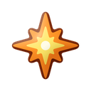
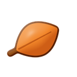
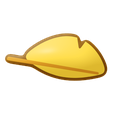

# Effects

Small effect sprites that go with the brawlers. Transparent PNGs, 128 × 128 px, drawn in the
same style as the shaded brawlers: flat colour, an outline in a darker shade, and soft
shading from the top left.

| Preview | File | Goes with | Idea |
|:---:|---|---|---|
|  | `spark.png` | TNT | Lit fuse: sits on the tip of the fuse |
|  | `sparkle.png` | Mage | Magic twinkles around the staff |
|  | `flame.png` | Dragon | Small flames near the dragon |
|  | `wisp.png` | Ghost | Mist trailing low at the sides |
|  | `leaf.png` | Acorn | Leaves drifting around |
|  | `bubble.png` | Octopus | Bubbles rising |
|  | `feather.png` | Peep | Feathers floating |

They are meant to be used sparingly: one to three small ones per card, as in
[`examples/`](../examples/). In the game they can be animated (drift, spin, fade), which the
still examples cannot show.

## Regenerating

The sprites are drawn by code, not cut from an image. Needs `numpy` and `Pillow`. Run this
from the repo root:

```bash
python3 scripts/make_effects.py
```
