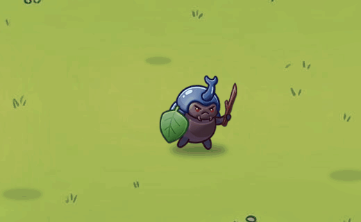

# Enemies

The bad guys the brawlers fight on the map. They are made like the brawlers: a still sprite,
a walk and an attack with smooth motion, and the effect of the attack. Everything faces left,
toward the brawlers, who come from the left.



| Enemy | Folder | Size | Walk | Attack |
|---|---|---|---|---|
| Beetle Knight | `beetle/` | 0.8 | Marches with its leaf shield in front | Winds up and slashes with its twig sword |

The size is next to the brawlers, like in [`brawlers/sizes.json`](../brawlers/sizes.json),
where the Mage is 1.

## Files

Each enemy has a folder:

| File | What it is |
|---|---|
| `still.png` | The still sprite, shaded like the brawlers |
| `walk.png`, `attack.png` | 4 frames side by side, facing left |
| `walk_mirrored.png`, `attack_mirrored.png` | The same, facing right |
| `attack_effect.png` | The effect of the attack, in 4 steps: it appears, grows, hits and breaks up |

[`enemies.json`](enemies.json) has the same fields as
[`animations/animations.json`](../animations/animations.json), plus `scale` (the size above)
and `still`. Play an enemy exactly like a brawler (see
[`animations/README.md`](../animations/README.md)), with one difference: its frames and motion
face left, so the motion's `x` is negative when it lunges at the brawlers. To make it face
right, use the mirrored strips, flip the sign of `x` and `rotate`, and flip the effect's
picture and the sign of the first number of its `at`.

## How the Beetle Knight is made

The originals are in [`source/`](source/):

- `beetle.png`: the Beetle Knight on its own
- `beetle_sheet.png`: 8 poses, the walk on the top row and the attack below
- `beetle_slash.png`: the slash of its sword, in 4 steps

Gemini drew the sheet facing right, like the brawlers' sheets, so it is cut out, lined up,
timed and shaded like theirs (see [`scripts/extract_animations.py`](../scripts/extract_animations.py)),
and only turned around at the end.

Gemini never drew the strike itself: however it was asked, the sword stayed pulled back. So
the strike is made from the ready pose: the sword and the hand that holds it are taken off and
put back in front of the body, swung down past the shield at the brawlers. The third pose of
the sheet's bottom row is not used. The slash appears in front of the beetle as the hit lands,
like the brawlers' attack effects.

Its motion is with the brawlers' in [`scripts/brawler_motion.py`](../scripts/brawler_motion.py):
a waddle for the walk, and for the attack a lunge with a little hop as it winds up.

To regenerate everything (needs `numpy` and `Pillow`; takes about half a minute), run this
from the repo root:

```bash
python3 scripts/make_enemies.py
```

## A new enemy

1. Ask Gemini for the enemy (attach the picture of our brawlers), then for its sheet and its
   attack effect (attach the enemy). The Beetle Knight's prompts are below.
2. Save them in `enemies/source/` as `<enemy>.png`, `<enemy>_sheet.png` and `<enemy>_slash.png`.
3. Add it to `ENEMIES` in [`scripts/make_enemies.py`](../scripts/make_enemies.py), and its walk
   and attack to the tables in `scripts/brawler_motion.py`.
4. Run the script.

<details>
<summary>The Beetle Knight's prompts</summary>

The enemy, with the picture of our brawlers attached:

```text
Use the attached picture as the style reference: these are the heroes of my game. Draw a NEW character in exactly the same style: the same cute chibi proportions, the same thick dark outlines, the same flat colours with very soft simple shading, the same small simple faces and the same amount of detail. Keep it minimal.

The character is an enemy: a small beetle knight. A chubby beetle standing upright on two short stubby dark legs, with a shiny deep blue shell on its back like armour, a short curved horn on its head like a helmet crest, and two tiny arms. In one arm it holds a sharpened twig as a sword, in the other a big green leaf as a shield.

Make it clearly a bad guy, with just a few simple touches:
- angry slanted eyebrows and small bright red eyes
- two small sharp pincers at its mouth
- a mean, determined frown, like a guard who won't let anyone pass

Pose: standing, turned a little to the left, toward the heroes, leaf shield raised, twig sword ready.

Draw only this one character, big and centred, on a solid flat magenta background (#FF00FF) with no gradient. Square picture (1:1).

Rules:
- No shadow under it, no ground, no glow: just the character on flat magenta.
- Light from the top left.
- No pink or purple anywhere on the character, not even in the shine on its shell, because the magenta background will be removed by its colour.
- No text, no labels.
```

The sheet, with the enemy attached:

```text
Use the attached picture: it is an enemy in my game. Draw an animation sheet of exactly this character: the same design, colours, proportions, thick dark outlines, horn helmet, twig sword and leaf shield, at the same size in every pose.

Wide picture (16:9) with 2 rows of 4 poses. In every pose the character is seen from the side, facing left (toward the heroes).

Top row, walking (a loop that repeats):
1. left foot forward
2. feet together, body a little higher
3. right foot forward
4. feet together, body a little higher
It marches with the leaf shield held in front and the twig sword held up.

Bottom row, attacking with the twig sword:
1. ready: standing, shield in front, sword up
2. wind-up: the sword pulled back high over its head, body leaning back
3. strike: the sword swung forward and down in front of it, body leaning in
4. back to the ready pose

Rules:
- Every pose stands alone with plenty of empty space around it: poses do not touch each other or the edges.
- Same size in every pose, feet on one line in each row.
- Keep its colours exactly as in the attached picture, and do not add any pink or magenta to it.
- Solid flat magenta background (#FF00FF) with no gradient, no shadows, no ground, no motion lines, no effects, no text, no numbers.
```

The slash, with the sheet attached:

```text
Use the attached picture as the style reference: the same cartoon style, the same thick dark outlines and flat colours. Draw the effect of this beetle's sword attack: one slash, as 4 steps of an animation in one row, from left to right:
1. a thin curved slash line just appearing
2. a wide curved slash arc, like the swoosh of a sword swing, curving from the top right down to the bottom left
3. the same arc at its biggest, with a few small sparks at its end
4. the arc breaking up into a few small fading pieces

The slash is white with a light blue edge and a dark outline: simple, flat, no glow.

Wide picture (16:9). Every step stands alone with plenty of empty space around it, on a solid flat magenta background (#FF00FF) with no gradient. No shadows, no text, no numbers, and no pink or purple in the effect.
```

</details>
