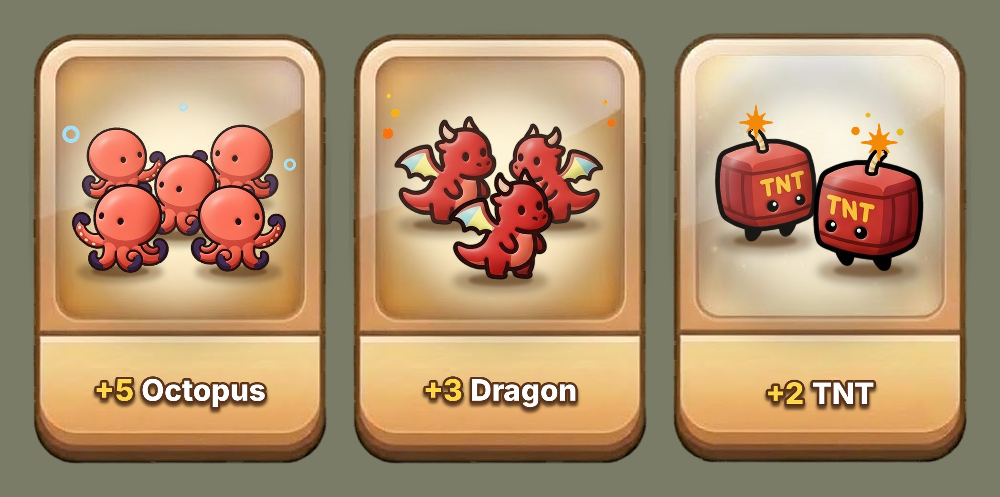

# Examples

Previews of how the brawlers look on the cards. These are **not game assets**. They show the
intended look, so the game can be built to match.

## Cards




What each card shows:

- **A group, not one brawler:** "+5 Peep" shows five Peeps.
- **True sizes:** every brawler is drawn at its own size from [`brawlers/sizes.json`](../brawlers/sizes.json),
  so a Peep is half as tall as a Mage. A group is only shrunk if it would not fit in the window.
- **Shaded brawlers:** the 3D-shaded sprites from [`brawlers/shaded/`](../brawlers/shaded/).
- **Mixed directions:** the brawlers in a group look in different directions, using the
  mirrored sprites from [`brawlers/shaded_mirrored/`](../brawlers/shaded_mirrored/), with
  slightly different sizes and tilts. The mirrored TNT still reads "TNT".
- **Grounding:** each brawler has a wide soft shadow plus a small dark one under its feet, the
  back row fades slightly for depth, and there is a soft glow behind the group.
- **Minimal particle effects:** three to five flat shapes per card from
  [`effects/pieces/`](../effects/pieces/), each brawler using its own cluster: feathers for
  the Peep, a spark on every TNT fuse, embers for the Dragon, glints at the Mage's staff, mist
  for the Ghost, leaves for Mr Nut and bubbles for the Octopus. In the game these would move;
  the previews show one moment.
- **Label:** gold number and white name, with a dark outline and a drop shadow.

The label font is a placeholder (whatever bold font the script finds), not the game's font.

## Size lineup


## Shading, before and after

Top row: the flat sprites. Bottom row: the shaded ones.


## Regenerating

Needs `numpy` and `Pillow`. Run this from the repo root:

```bash
python3 scripts/make_card_examples.py
```
