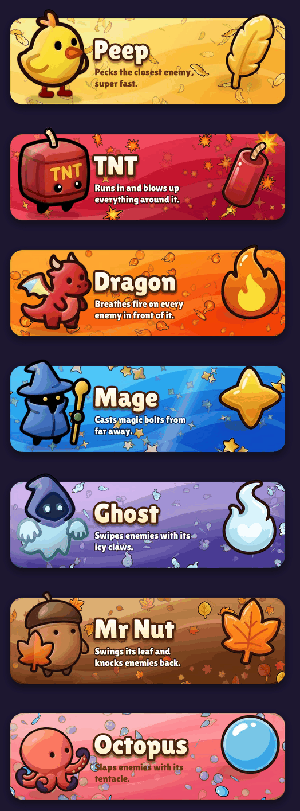
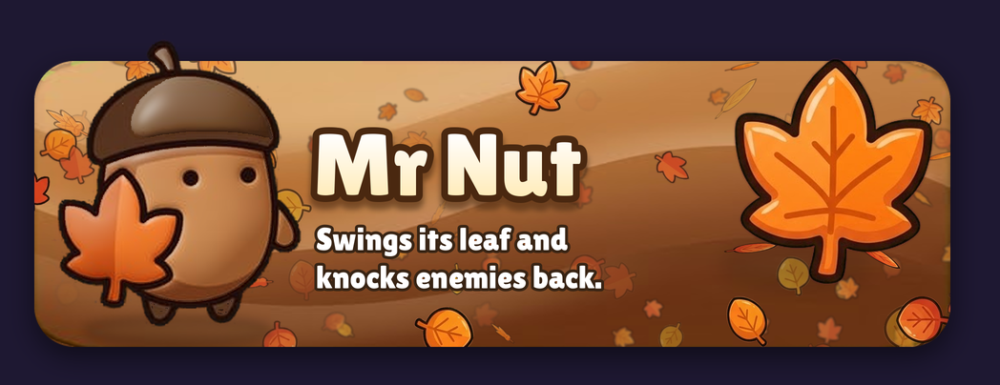
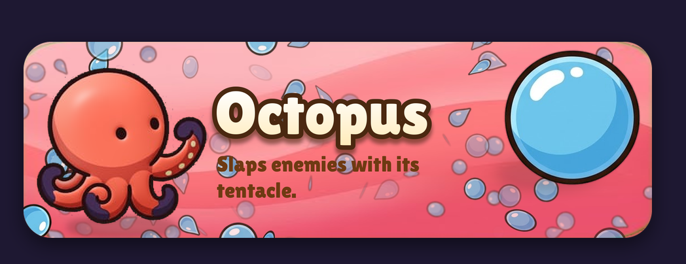
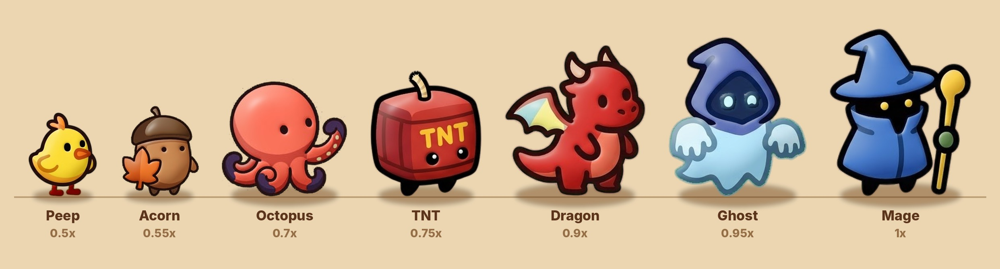

# Examples

Previews of how the brawlers look on the cards, in motion and on the map, and of the enemies.
These are **not game assets**.
They show the intended look, so the game can be built to match.

## Brawler cards

The cards from [`cards/`](../cards/), one per brawler. All seven:



Three of them stacked like on the real screen:


Every card as a full-size still:





The skill texts are placeholders. Every card's own moving preview is about 8 MB, so they are
not kept here; [`cards/README.md`](../cards/README.md) says how to make them.

## Animations

The walk (top) and attack (bottom) of every brawler, from [`animations/`](../animations/):
the 4 drawn poses of each animation, played together with its smooth motion and its effects
(dust and sparkles for the steps, fire and sparks for the attacks), at 25 pictures a second.
Every brawler is drawn at the same size here, so the motion is easy to judge.


## The forest map

The whole map from [`maps/`](../maps/), at a third of its size. It loops: its right edge joins
its left edge.


[`map_forest.mp4`](map_forest.mp4) shows Peep, the Mage and the TNT walking once round the loop,
at their real sizes, with the map alive: trees and plants swaying in the wind, leaves and petals
falling, butterflies, a bird flying over, and flowers and grass that bend and pop petals or
leaves as the brawlers walk through them (35 seconds; the video loops seamlessly too). One
picture of it:


## Enemies

The Beetle Knight from [`enemies/`](../enemies/), at its real size on the forest path: it
marches at the brawlers, then winds up and slashes with its twig sword.


## Size lineup



## Shading, before and after

Top row: the flat sprites. Bottom row: the shaded ones.


## Regenerating

Needs `numpy` and `Pillow`. Run these from the repo root. The card previews:

```bash
python3 scripts/make_brawler_cards.py
```

The animation preview:

```bash
python3 scripts/extract_animations.py
```

The map previews (the video needs `ffmpeg`):

```bash
python3 scripts/make_map.py
```

The enemy previews:

```bash
python3 scripts/make_enemies.py
```

The size lineup and the shading comparison:

```bash
python3 scripts/make_examples.py
```
