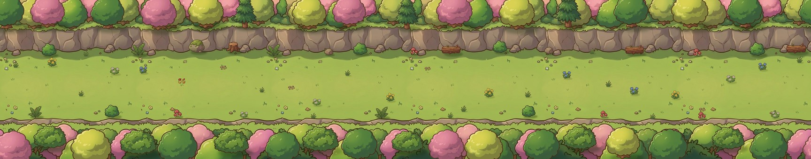
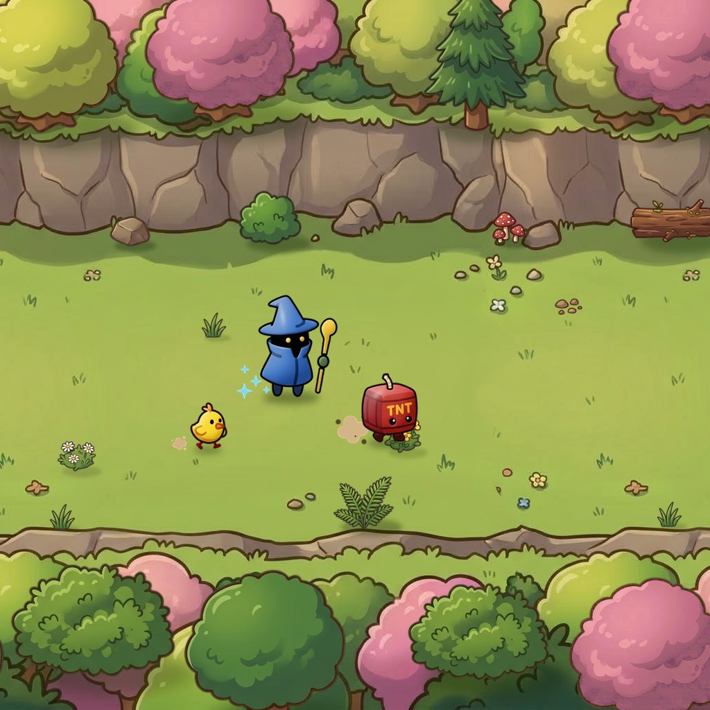

# Maps

The map at the top of the main screen: a path seen from above, between two walls, that the
brawlers walk along from left to right while they fight. Each area has its own map. The first
one is the forest.



That is the whole forest map, at a third of its size. It is about 5 screens long, and its right
edge joins its left edge, so the brawlers can walk along it forever.
[`map_forest.mp4`](../examples/map_forest.mp4) shows three of them walking once round it.

One screen of it at full size, with the brawlers at their real sizes:



## Files

Each area has a folder (`forest/`):

| File | What it is |
|---|---|
| `map.png` | The whole map, ready to scroll: 5184 × 1024 px |
| `map.json` | Its size, where the characters walk, and where every decoration is |
| `tile.png` | The bare map without the decorations, 864 × 1024 px. It repeats seamlessly side by side |
| `props/<name>.png` | Every decoration, cut out: trees, bushes, rocks, a stump, a log, mushrooms, flowers... |
| `source/` | The two original pictures |

Most games only need `map.png`.

## How to use it

- **Size:** one screen shows 1024 px of the map's width, at its full height. Scale the map so
  its height fills the map panel; a square panel then shows one screen.
- **Scrolling:** move the map to the left as the brawlers walk. When the scroll reaches the end
  of the map (5184 px), carry on from 0: the end joins the start seamlessly. The easiest way is
  to draw the map twice, side by side.
- **Where characters stand:** on the open grass, between y = 380 and y = 740 (`walk` in
  `map.json`). Enemies too. Draw them all on top of the map: the decorations are along the
  walls or flat on the grass, so nothing needs to be drawn in front of a character.
- **Very wide pictures:** some phones cannot show a picture more than 4096 px wide. If the game
  has to run on those, cut `map.png` into two or more pieces and draw them side by side, or
  build the map from the tile and the decorations (below).

[`map.json`](forest/map.json) has:

| Field | Meaning |
|---|---|
| `size` | Width and height of `map.png` |
| `loops` | `true`: the right edge joins the left edge |
| `screen` | How much of the map's width one screen shows (with a square map panel) |
| `walk` | Top and bottom (y) of the open grass where characters stand |
| `tile` | The bare tile, and how many times it repeats across the map |
| `props` | Every decoration, in the order they are drawn (back to front) |

For each decoration:

| Field | Meaning |
|---|---|
| `file` | Its picture |
| `x`, `y` | Where its foot goes on the map: the middle of the bottom of its trunk, stem or stone |
| `foot` | The row of its foot in its own picture |
| `scale` | How much to scale its picture |
| `shadow` | How strong its shadow is: 1, ½ for flowers and grass, 0 for pebbles and leaves |

To build the map yourself (for instance to make the trees sway): draw the tile `repeat` times
side by side, then every decoration in order, scaled by `scale`, with its top left corner at
`x - width × scale / 2` and `y - foot × scale`. A decoration near either end hangs over it:
draw it again one map width further left or right. In `map.png`, every decoration also has a
soft dark oval under its foot, as wide as the decoration and shifted a little to the right
(the light comes from the top left), at the strength given by `shadow`.

## How it is made

Gemini cannot draw one sharp picture 5 screens long, so the map is built from two pictures:

- `source/base.jpg`: one square screen of the path, drawn so it can repeat side by side
- `source/props.jpg`: the decorations, on a magenta screen

The script then:

1. **Makes the base repeat seamlessly.** It lays the base's right end over its left start and
   joins them along the line where they look most alike. It also evens out the patches of
   light on the grass, which would otherwise line up in a row along the map.
2. **Cuts the decorations out**, and paints a copy of the light green tree pink, to match the
   pink trees in the base.
3. **Lays the tile out 6 times and spreads the decorations along it**, in lanes: trees on top
   of the cliff, rocks and plants at its foot, flowers on the grass, small plants along the
   bottom edge, and big trees and bushes at the front. They are placed at random, but the same
   way every time, so no two screens look the same.

The placement is described in `AREAS` at the top of
[`scripts/make_map.py`](../scripts/make_map.py): which decorations each lane uses and how
often, how far apart they are, how big each one is, and a `seed`: change it to shuffle them.

To regenerate everything (needs `numpy` and `Pillow`, plus `ffmpeg` for the video; takes about
a minute), run this from the repo root:

```bash
python3 scripts/make_map.py
```

## A new area

1. Ask Gemini for the area's two pictures. The forest's prompts are below: change what they
   say about the forest, and attach a picture of the forest map with the first one, so the new
   area keeps the same style.
2. Save them in `maps/<area>/source/` as `base.jpg` and `props.jpg`.
3. Add the area to `AREAS` in `scripts/make_map.py`: its decorations in reading order, how wide
   each one is on the map, and its lanes.
4. Run the script.

<details>
<summary>The forest's prompts</summary>

The base, with the style reference attached:

```text
Use the attached picture ONLY as the art style reference: the same cozy cartoon style, the same thick dark-brown outlines, the same soft shading, the same warm colours and the same amount of detail. Do NOT copy its layout or its camera angle.

Draw a square (1:1) background for a mobile idle RPG: a piece of a forest path seen from above. The camera looks down from high above at a steep angle, like in top-down mobile games: you see the tops of things and a little of their front. There is no sky and no horizon.

The path runs straight across the picture from the left edge to the right edge, between two walls. A small team of heroes will walk along it from left to right and fight enemies on it, so it must be wide, flat and open. The heroes are small, each about one eighth of the picture tall.

From top to bottom:
1. Top quarter: a rocky cliff wall, warm grey-brown stone with a few cracks, running straight and level across the whole width. On top of the cliff grows a thick forest: a row of round, fluffy treetops.
2. Middle half: the path, soft green grass, flat and open. Keep it almost empty: only tiny grass tufts, a few tiny pebbles and a few tiny flowers, spread thinly and evenly. A soft shadow along the foot of the cliff.
3. Bottom quarter: the grass ends at a low rocky edge, and below it the tops of leafy bushes and trees fill the bottom of the picture, running straight across the whole width.

Very important:
- This picture will be repeated side by side many times to make one long map, so it must tile seamlessly from left to right. The cliff, the rocky edge and the grass continue straight off the left and right edges at exactly the same height on both sides.
- No landmarks anywhere: no pond, no big rock, no fallen tree, no special tree. Everything is spread evenly, so the repeat does not show.
- Light comes from the top left, shadows fall to the bottom right.
- No characters, no animals, no enemies, no text, no UI, no border.
```

The decorations, in a new chat, with the base attached:

```text
Use the attached picture as the reference: the same cozy cartoon style, the same thick dark-brown outlines, the same shading, the same colours, and the same camera angle, seen from above. Make a NEW picture, do not edit the attached one.

Draw a sheet of separate forest decorations for this map, on a solid flat magenta background (#FF00FF) with no gradient. Square picture (1:1). Every item stands alone, complete, with plenty of empty magenta around it: no item touches another item or the edge of the picture.

The items:
- 2 big round leafy trees, one dark green, one lighter yellow-green, with their short trunks showing
- 1 tall pine tree
- 1 big leafy bush and 1 small bush
- 1 big mossy rock and 1 small rock
- 1 tree stump and 1 fallen log
- 1 fern
- 1 small cluster of red mushrooms with white dots
- 3 small flower patches: white daisies, yellow flowers, blue flowers
- 1 grass tuft
- 1 small group of pebbles
- 1 small group of fallen leaves

Draw the trees big (each about a quarter of the picture tall) and the small things small.

Rules:
- No shadows on the background under the items, no glow: just the items on flat magenta.
- Light from the top left, like the attached picture.
- No pink or purple on any item, because the magenta background will be removed by its colour.
- No characters, no text, no labels, no numbers.
```

</details>
